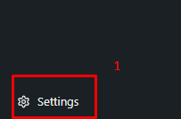
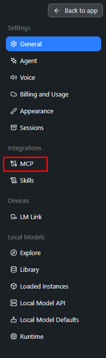
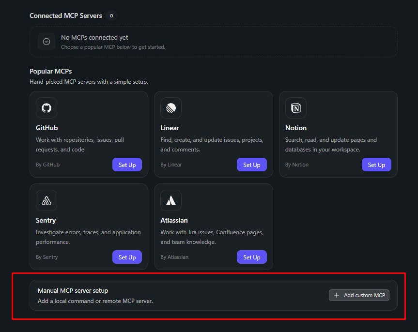
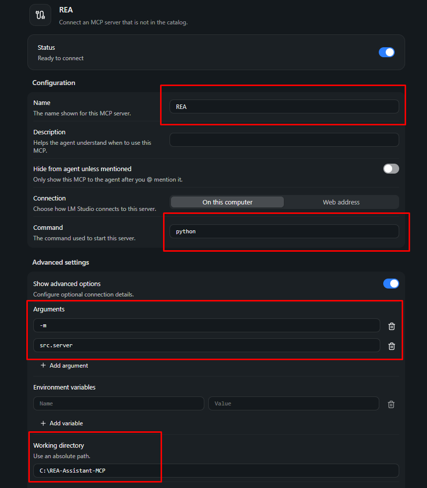
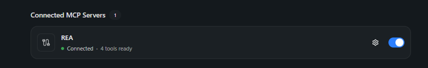

# REA-Assistant-MCP

A local, free, and privacy-preserving Model Context Protocol (MCP) server for reverse engineering workflows.

REA-Assistant-MCP connects a local LLM client such as LM Studio to a set of practical binary-analysis tools. It allows an AI assistant to inspect executable files, extract strings, read raw bytes, and execute command-line analysis tools without sending files to a remote service.

## What this project does

This project turns a local language model into a reverse engineering assistant by exposing tools over MCP. The server can:

- Analyze a file's basic metadata
- Extract readable strings from PE/ELF binaries
- Read hex dumps at specific offsets
- Execute selected CLI-based analysis tools via subprocess

## Features

- Binary metadata inspection
  - File size
  - SHA256 hash
  - Magic bytes
  - Basic format identification
- String extraction
  - Dump readable ASCII strings from binaries
  - Useful for spotting embedded paths, URLs, or suspicious indicators
- Hex inspection
  - Read byte chunks from a file at a specified offset
  - Helpful for quick header and payload review
- CLI tool execution
  - Run external reverse engineering utilities in a controlled way
  - Expose the results back to the MCP client

## Project structure

```text
REA-Assistant-MCP/
├── src/
│   ├── __init__.py
│   ├── binary_tools.py
│   ├── cli_runner.py
│   └── server.py
├── requirements.txt
├── README.md
└── .gitignore
```

## Requirements

- Python 3.10+
- LM Studio (with MCP support)

## Install

```bash
git clone https://github.com/khtab0x/REA-Assistant-MCP.git
cd REA-Assistant-MCP
python -m venv .venv
source .venv/bin/activate  # Windows: .venv\Scripts\activate
pip install -r requirements.txt
```

## Run the server

```bash
python -m src.server
```

This starts the MCP server over stdio, which is the transport expected by clients such as LM Studio.

## Step-by-Step GUI Setup (LM Studio)

Connect the REA-Assistant to LM Studio using the built-in MCP configuration UI.

### Step 1: Open Settings

Open LM Studio and click the Settings gear icon in the lower-left area of the window.



### Step 2: Navigate to MCP Integrations

In the left sidebar, scroll down to the Integrations section and click on MCP.



### Step 3: Add Custom MCP Server

Scroll down to the Manual MCP server setup section and click the Add custom MCP button.



### Step 4: Configure the Server

Fill in the server details exactly as shown below:

- Name: REA
- Command: python
- Arguments:
  - `-m`
  - `src.server`
- Working directory: the folder where you downloaded this project



### Step 5: Verify Connection

Save the configuration. Within a few seconds, the status should turn green and show Connected · 4 tools ready.



You are all set! Open a chat with any local model in LM Studio, and it will now have access to your reverse engineering tools.

## Example usage

Once connected, you can ask your local model to use the tools in natural language, for example:

- "Analyze this binary and report its basic file information."
- "Extract readable strings from this executable and look for suspicious URLs."
- "Read the hex at offset 0x1000 and inspect the header."

## Tools exposed by the server

The server registers the following MCP tools:

- `analyze_file_basic`
- `extract_binary_strings`
- `read_hex_chunk`
- `run_cli_tool`

## Notes

This project is intended for local analysis and educational use. It is designed to help AI-assisted reverse engineering workflows while keeping data local to the machine running the model.

## License

This project currently does not specify a license file in the repository metadata. Please check the repository settings or upstream project documentation before using it in a production or commercial context.
